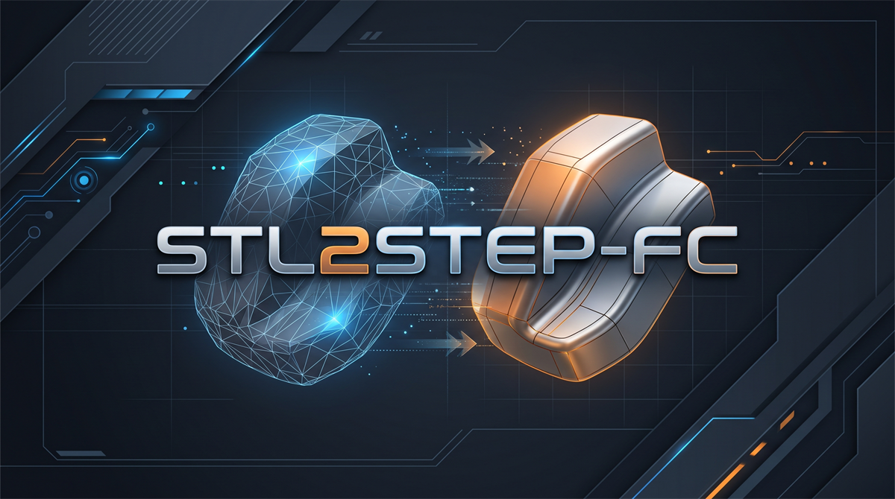

# STL2STEP FC

Convert **STL** meshes (3D printing) into editable **STEP** CAD models for FreeCAD,
Fusion 360, SolidWorks, Onshape and more — powered by OpenCASCADE.

*Converti i mesh **STL** (stampa 3D) in modelli **STEP** modificabili in FreeCAD,
Fusion 360, SolidWorks, Onshape e altri CAD — basato su OpenCASCADE.*

```
STL (triangles)  ──▶  primitive detection  ──▶  STEP (exact BRep)
                      planes · cylinders · spheres · cones
```



> **0.2.2** — nuova splash screen e avvio molto più rapido: il motore CAD
> (OpenCASCADE/SciPy) viene caricato alla prima conversione, non all'avvio.
>
> **0.2.2** — new splash screen and much faster startup: the CAD engine
> (OpenCASCADE/SciPy) is loaded on the first conversion instead of at launch.

---

## English

An STL file is just a cloud of triangles; a parametric STEP is exact geometry
(planes, cylinders, spheres, cones). **STL2STEP FC** reconstructs analytic
surfaces directly from the mesh, so your part becomes **editable** again instead
of being frozen into triangles.

### Features

- **Powerful engine**: parametric reconstruction built on OpenCASCADE (OCP).
- **Three conversion modes**:
  - **Parametric** — detects planes, cylinders, spheres and cones and rebuilds
    them as exact CAD geometry (true editable NURBS surfaces and solids).
  - **Tessellated** — faithful mesh-to-solid conversion (for organic shapes).
  - **Automatic** — picks the best strategy based on the file content.
- **Ready-made profiles** ("templates"): *Mechanical*, *Organic*, *High precision*,
  *Fast*, plus fully customisable parameters.
- **Modern GUI** with interactive 3D preview (rotate/zoom), batch queue,
  progress bar and log.
- **CLI** for automation and scripting.
- **Fast startup**: the window opens without loading the CAD kernel; OpenCASCADE
  and SciPy are loaded only on the first conversion.
- **Safety net**: if the parametric reconstruction diverges from the mesh, the
  software automatically falls back to tessellated mode so the result is always
  geometrically correct.

### Installation

#### AppImage (recommended)

Download the AppImage from the [Releases page](https://github.com/FSMaker77/STL2STEP-FC/releases/latest):

```bash
wget https://github.com/FSMaker77/STL2STEP-FC/releases/download/v0.2.2/STL2STEP-FC-0.2.2-Linux-x86_64.AppImage
chmod +x STL2STEP-FC-0.2.2-Linux-x86_64.AppImage
./STL2STEP-FC-0.2.2-Linux-x86_64.AppImage          # launches the GUI
./STL2STEP-FC-0.2.2-Linux-x86_64.AppImage --help   # CLI
```

If FUSE is unavailable, run with `--appimage-extract-and-run`.

The AppImage is an optimized bundle (~190 MB): it contains only the Python
modules, Qt libraries and OpenCASCADE/VTK runtime files actually used by STL2STEP.

#### Windows 11 (64-bit)

Two packages are available from the [Releases page](https://github.com/FSMaker77/STL2STEP-FC/releases/latest):

- **Setup (recommended)** — [`STL2STEP-FC-0.2.2-Windows-x86_64-Setup.exe`](https://github.com/FSMaker77/STL2STEP-FC/releases/download/v0.2.2/STL2STEP-FC-0.2.2-Windows-x86_64-Setup.exe).
  Per-user installer (no administrator rights), installs under
  `%LOCALAPPDATA%\Programs\STL2STEP`, and creates Start Menu and uninstaller
  entries. Download the matching `.sha256` file to verify the installer.
- **Portable (no installation)** — [`STL2STEP-FC-0.2.2-Windows-x86_64-Portable.zip`](https://github.com/FSMaker77/STL2STEP-FC/releases/download/v0.2.2/STL2STEP-FC-0.2.2-Windows-x86_64-Portable.zip).
  Extract the whole folder and run `STL2STEP.exe`. Do not run it from inside the
  ZIP. It needs no Python installation and no administrator rights; the CLI is
  available as `stl2step-cli.exe`. The package includes `diagnostica.bat`, which
  writes `diagnostica.txt` with the exact DLL/loading problem if startup fails.

Both packages bundle Python, OpenCASCADE (OCP), VTK and PySide6, so no separate
Python installation is needed. They are not code-signed, so Windows SmartScreen
may show a warning.

#### From source

Requires Python ≥ 3.10 and a Linux environment (tested on Debian/Kali/Ubuntu).

```bash
git clone https://github.com/FSMaker77/STL2STEP-FC.git
cd STL2STEP-FC
./build.sh      # creates .venv and installs dependencies
./run.sh        # launches the GUI
```

Or manually:

```bash
python3 -m venv .venv
./.venv/bin/pip install -r requirements.txt
./.venv/bin/pip install -e .
./.venv/bin/python -m stl2step
```

Both install paths provide the `stl2step` (CLI) and `stl2step-gui` (GUI) commands; `python -m stl2step` launches the GUI without arguments and the CLI with arguments.

### Usage

#### GUI

1. **Add files** or **Add folder** with your STL files.
2. Pick a **profile** (or tweak the parameters manually).
3. Choose an **output folder** (default: next to the source file).
4. Press **Convert all**.

#### CLI

```bash
# convert one file with the "mechanical" profile
stl2step -p mechanical -o ./output part.stl

# convert a whole folder in parametric mode
stl2step -m parametric ./my_stl/

# list available profiles
stl2step --list-profiles

# manual parameters
stl2step --angle 5 --distance 0.01 part.stl
```

### Conversion profiles (templates)

Profiles are JSON files under `stl2step/data/profiles/`. Create your own by
copying one and editing the values:

| Profile         | Use case                                                   |
|-----------------|------------------------------------------------------------|
| `mechanical`    | Parts with flat and cylindrical faces (parametric rebuild) |
| `organic`       | Sculptures / freeform shapes (faithful tessellated STEP)   |
| `high_precision`| Tight tolerances for reuse in CAD                          |
| `fast`          | Quick conversion with loose tolerances                     |

Main parameters:

- **mode** — `auto` / `parametric` / `tessellated`
- **angular_tolerance_deg** — max angle (degrees) between faces of the same region
- **distance_tolerance** — max distance of a triangle from the analytic surface
- **min_region_faces** — minimum faces to accept a region
- **detect_cylinders / detect_spheres / detect_cones** — primitives to detect
- **make_solid** — build a solid when the mesh is closed

### Architecture

```
stl2step/
├── core/
│   ├── stl_io.py        # STL read/write (binary + ASCII)
│   ├── mesh.py          # mesh + cleanup (weld, degenerate, watertight)
│   ├── primitives.py    # plane/sphere/cylinder/cone fitting (RANSAC, SVD, least-squares)
│   ├── segmentation.py  # primitive region detection (RANSAC + region growing)
│   ├── brep.py          # BRep face/solid reconstruction (OpenCASCADE)
│   └── convert.py       # conversion orchestrator + safety net
├── gui/                 # Qt interface (PySide6)
├── profiles/            # profile loader
├── data/profiles/       # JSON templates
├── cli.py               # command-line interface
└── samples/             # sample STL generator
```

### Known limitations (honesty first)

- **Full planes, cylinders, spheres and cones** are rebuilt as exact parametric
  geometry (a sphere becomes a ~2 KB solid instead of a 10 MB file).
- **Partial primitives** (spherical caps, half cylinders, fillets) may fall back
  to triangulation.
- Reconstruction quality depends on mesh resolution: very coarse meshes (e.g. a
  cube with 2 triangles per face) may not segment correctly.
- The mesh must be consistently oriented to produce a solid; tessellated mode is
  always available as a fallback.

### Tests

```bash
./.venv/bin/python samples/generate_samples.py   # generate sample STL files
./.venv/bin/python tests/test_core.py            # engine tests
```

### Building an AppImage

```bash
./build.sh                      # prepare the environment
./packaging/build_appimage.sh   # generates dist/STL2STEP-FC-*.AppImage
```

### Building the Windows installer (from Linux)

The Windows package is an NSIS setup, not a single-file executable: the bundled
Python runtime and dependencies are installed as normal files.

```bash
./packaging/windows/build_windows.sh
# -> dist/STL2STEP-FC-<version>-Windows-x86_64-Setup.exe

./packaging/windows/build_portable_zip.sh
# -> dist/STL2STEP-FC-<version>-Windows-x86_64-Portable.zip
```

Build requirements: `python3` + `pip`, `curl`, `unzip`, `zip`, NSIS
(`makensis`), MinGW-w64 (`x86_64-w64-mingw32-gcc`/`-windres`) and ImageMagick
`convert`. The first build downloads the Windows wheels and the Python
embeddable runtime. The installer is created per-user and does not require
administrator privileges. The portable ZIP is generated from the same payload.
If a Python 3.12 interpreter is available (`PYC_PYTHON=python3.12`), the build
also ships precompiled bytecode; otherwise the NSIS installer compiles it once
at install time.

### License

MIT — see [LICENSE](LICENSE). The OpenCASCADE (OCP) CAD kernel is distributed
under LGPL 2.1 with exception.

---

## Italiano

Un file STL è solo una nuvola di triangoli; uno STEP parametrico è una geometria
esatta (piani, cilindri, sfere, coni). **STL2STEP FC** ricostruisce le superfici
analitiche direttamente dal mesh, così il tuo pezzo torna a essere **modificabile**
invece di restare congelato in triangoli.

### Caratteristiche

- **Motore potente**: ricostruzione parametrica basata su OpenCASCADE (OCP).
- **Tre modalità di conversione**:
  - **Parametrica** — rileva piani, cilindri, sfere e coni e li ricostruisce come
    geometria CAD esatta (vere superfici NURBS e solidi modificabili).
  - **Tassellata** — conversione fedele del mesh in un solido STEP (per forme organiche).
  - **Automatica** — sceglie la strategia migliore in base al contenuto del file.
- **Profili pronti** ("templates"): *Meccanico*, *Organico*, *Alta precisione*,
  *Veloce*, più parametri completamente personalizzabili.
- **GUI moderna** con anteprima 3D interattiva (rotazione/zoom), coda di
  conversione batch, barra di avanzamento e log.
- **CLI** per automazione e script.
- **Avvio rapido**: la finestra si apre senza caricare il motore CAD;
  OpenCASCADE e SciPy vengono caricati solo alla prima conversione.
- **Rete di sicurezza**: se la ricostruzione parametrica diverge dal mesh, il
  software passa automaticamente alla modalità tassellata per garantire sempre un
  risultato geometricamente corretto.

### Installazione

#### AppImage (consigliato)

Scarica l'AppImage dalla [pagina Releases](https://github.com/FSMaker77/STL2STEP-FC/releases/latest):

```bash
wget https://github.com/FSMaker77/STL2STEP-FC/releases/download/v0.2.2/STL2STEP-FC-0.2.2-Linux-x86_64.AppImage
chmod +x STL2STEP-FC-0.2.2-Linux-x86_64.AppImage
./STL2STEP-FC-0.2.2-Linux-x86_64.AppImage          # avvia la GUI
./STL2STEP-FC-0.2.2-Linux-x86_64.AppImage --help   # CLI
```

Se FUSE non è disponibile, esegui con `--appimage-extract-and-run`.

L'AppImage è un bundle ottimizzato (~190 MB): contiene solo i moduli Python, le
librerie Qt e i runtime OpenCASCADE/VTK effettivamente usati da STL2STEP.

#### Windows 11 (64 bit)

Dalla [pagina Releases](https://github.com/FSMaker77/STL2STEP-FC/releases/latest)
sono disponibili due pacchetti:

- **Setup (consigliato)** — [`STL2STEP-FC-0.2.2-Windows-x86_64-Setup.exe`](https://github.com/FSMaker77/STL2STEP-FC/releases/download/v0.2.2/STL2STEP-FC-0.2.2-Windows-x86_64-Setup.exe).
  Installer per-utente (non richiede privilegi di amministratore), installa in
  `%LOCALAPPDATA%\Programs\STL2STEP` e crea le voci nel menu Start e il
  disinstallatore. Scarica anche il file `.sha256` per verificare l'installer.
- **Portable (nessuna installazione)** — [`STL2STEP-FC-0.2.2-Windows-x86_64-Portable.zip`](https://github.com/FSMaker77/STL2STEP-FC/releases/download/v0.2.2/STL2STEP-FC-0.2.2-Windows-x86_64-Portable.zip).
  Estrai tutta la cartella e avvia `STL2STEP.exe`. Non eseguirlo dall'interno
  dello ZIP. Non richiede Python né privilegi di amministratore; la CLI è
  disponibile come `stl2step-cli.exe`. Il pacchetto include `diagnostica.bat`,
  che genera `diagnostica.txt` con l'eventuale DLL o errore di caricamento.

Entrambi includono runtime Python, OpenCASCADE (OCP), VTK e PySide6, quindi non
serve installare Python separatamente. Non sono firmati digitalmente: Windows
SmartScreen potrebbe mostrare un avviso.

#### Dai sorgenti

Richiede Python ≥ 3.10 e un ambiente Linux (testato su Debian/Kali/Ubuntu).

```bash
git clone https://github.com/FSMaker77/STL2STEP-FC.git
cd STL2STEP-FC
./build.sh      # crea .venv e installa le dipendenze
./run.sh        # avvia la GUI
```

Oppure manualmente:

```bash
python3 -m venv .venv
./.venv/bin/pip install -r requirements.txt
./.venv/bin/pip install -e .
./.venv/bin/python -m stl2step
```

Entrambe le opzioni installano i comandi `stl2step` (CLI) e `stl2step-gui` (GUI); `python -m stl2step` avvia la GUI senza argomenti e la CLI con argomenti.

### Utilizzo

#### GUI

1. **Aggiungi file** o **Aggiungi cartella** con i tuoi STL.
2. Scegli un **profilo** (o regola i parametri a mano).
3. Seleziona la **cartella di output** (default: accanto al sorgente).
4. Premi **Converti tutto**.

#### CLI

```bash
# converti un file con il profilo "mechanical"
stl2step -p mechanical -o ./output parte.stl

# converti una cartella intera in modalità parametrica
stl2step -m parametric ./miei_stl/

# elenco profili
stl2step --list-profiles

# parametri manuali
stl2step --angle 5 --distance 0.01 pezzo.stl
```

### Profili di conversione (templates)

I profili sono file JSON in `stl2step/data/profiles/`. Puoi crearne di tuoi
copiandone uno e modificando i valori:

| Profilo         | Uso                                                        |
|-----------------|------------------------------------------------------------|
| `mechanical`    | Parti con facce piane e cilindriche (ricostruzione parametrica) |
| `organic`       | Sculture/forme libere (STEP tassellato fedele)             |
| `high_precision`| Tolleranze strette per riuso in CAD                        |
| `fast`          | Conversione rapida con tolleranze ampie                    |

Parametri principali:

- **mode** — `auto` / `parametric` / `tessellated`
- **angular_tolerance_deg** — angolo massimo (gradi) tra facce della stessa regione
- **distance_tolerance** — distanza massima di un triangolo dalla superficie analitica
- **min_region_faces** — numero minimo di facce per accettare una regione
- **detect_cylinders / detect_spheres / detect_cones** — primitive da rilevare
- **make_solid** — genera un solido quando il mesh è chiuso

### Architettura

```
stl2step/
├── core/
│   ├── stl_io.py        # lettura/scrittura STL (binario + ASCII)
│   ├── mesh.py          # mesh + pulizia (weld, degenerate, watertight)
│   ├── primitives.py    # fitting piano/sfera/cilindro/cono (RANSAC, SVD, least-squares)
│   ├── segmentation.py  # rilevamento regioni primitive (RANSAC + region growing)
│   ├── brep.py          # ricostruzione facce BRep e solidi (OpenCASCADE)
│   └── convert.py       # orchestratore della conversione + rete di sicurezza
├── gui/                 # interfaccia Qt (PySide6)
├── profiles/            # caricatore profili
├── data/profiles/       # template JSON
├── cli.py               # interfaccia a riga di comando
└── samples/             # generatore di STL di esempio
```

### Limitazioni note (onestà prima di tutto)

- **Piani, cilindri, sfere e coni completi** vengono ricostruiti come geometria
  parametrica esatta (una sfera diventa un solido da ~2 KB invece di un file da 10 MB).
- **Primitive parziali** (calotte sferiche, mezzi cilindri, raccordi) possono
  ricadere sulla triangolazione.
- La qualità della ricostruzione dipende dalla risoluzione del mesh: mesh molto
  grossolane (es. un cubo con 2 triangoli per faccia) possono non essere
  segmentate correttamente.
- Il mesh deve essere orientato in modo coerente per ottenere un solido; la
  modalità tassellata è comunque sempre disponibile.

### Test

```bash
./.venv/bin/python samples/generate_samples.py   # genera STL di esempio
./.venv/bin/python tests/test_core.py            # test del motore
```

### Creare un AppImage

```bash
./build.sh                      # prepara l'ambiente
./packaging/build_appimage.sh   # genera dist/STL2STEP-FC-*.AppImage
```

### Creare l'installer Windows (da Linux)

Il pacchetto Windows è un setup NSIS, non un singolo eseguibile gigante: il
runtime Python e le dipendenze vengono installati come normali file.

```bash
./packaging/windows/build_windows.sh
# -> dist/STL2STEP-FC-<versione>-Windows-x86_64-Setup.exe

./packaging/windows/build_portable_zip.sh
# -> dist/STL2STEP-FC-<versione>-Windows-x86_64-Portable.zip
```

Requisiti di build: `python3` + `pip`, `curl`, `unzip`, `zip`, NSIS
(`makensis`), MinGW-w64 (`x86_64-w64-mingw32-gcc`/`-windres`) e ImageMagick
`convert`. La prima build scarica i wheel Windows e il runtime Python embeddable.
L'installer è per-utente e non richiede privilegi di amministratore. Il pacchetto
portabile viene generato dallo stesso payload.

### Licenza

MIT — vedi [LICENSE](LICENSE). Il kernel CAD OpenCASCADE (OCP) è distribuito
sotto LGPL 2.1 con eccezione.
